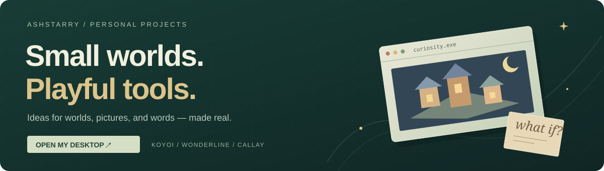
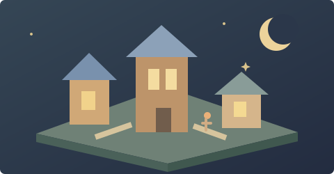
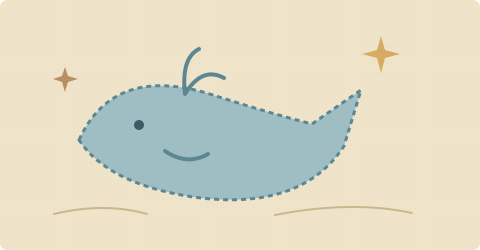
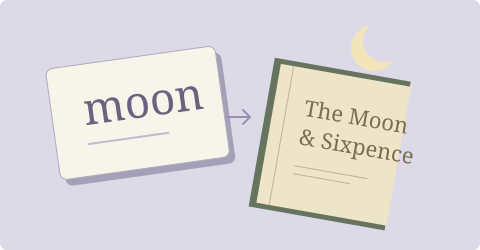

Hi, I'm **Shawn / ashstarry**. I make small tools and playful experiences for worlds, pictures, and words.

**[Explore my personal desktop ↗](https://ashstarry.github.io/)** · [LinkedIn](https://www.linkedin.com/in/dong-yuanshun/) · [Email](mailto:dongyuans@hotmail.com)

## Things I've made

<table>
  <tr>
    <td width="33%" valign="top">
      
      <h3>Koyoi</h3>
      
A living miniature town that responds to your words.

      
<a href="https://koyoi.fun/">Explore the town ↗</a> <a href="https://github.com/ashstarry/echoing-green">Source code</a>

    </td>
    <td width="33%" valign="top">
      
      <h3>Wonderline</h3>
      
Speak your ideas into a drawing, one stroke at a time.

      
<a href="https://wonderline.fun/">Try the drawing board ↗</a> <a href="https://github.com/ashstarry/wonderline">Source code</a>

    </td>
    <td width="33%" valign="top">
      
      <h3>Callay</h3>
      
A Mac input method with meanings and literary connections.

      
<a href="https://ashstarry.github.io/callay-site/">Explore the input method ↗</a> <a href="https://github.com/ashstarry/callay-site">Source code</a>

    </td>
  </tr>
</table>
